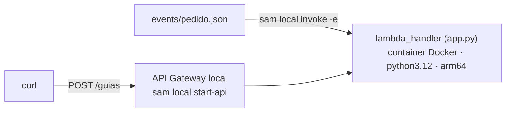
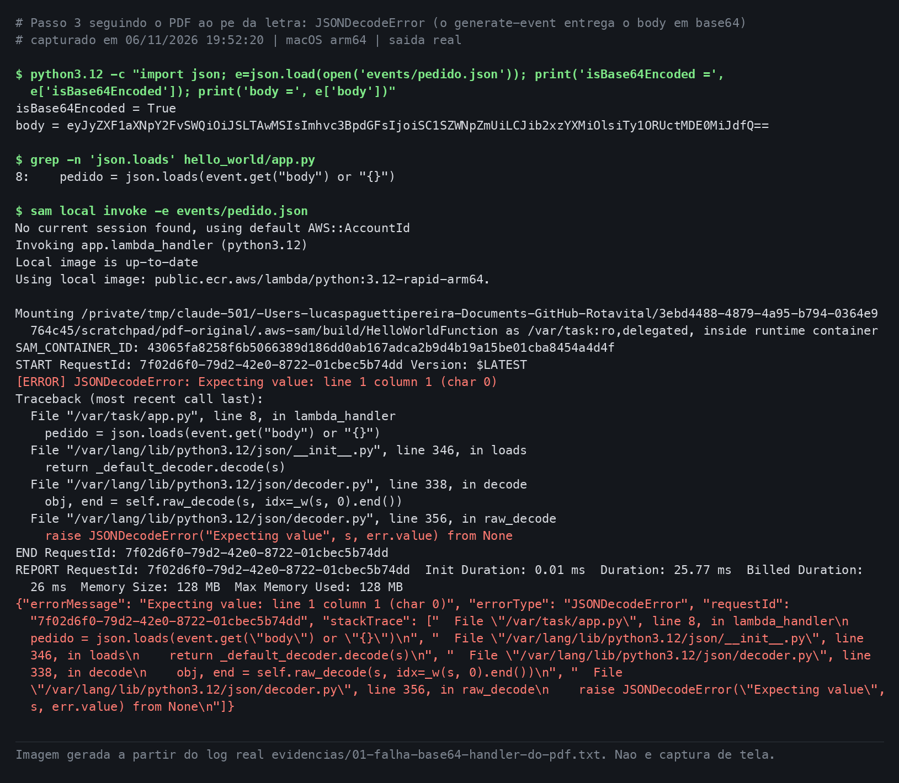
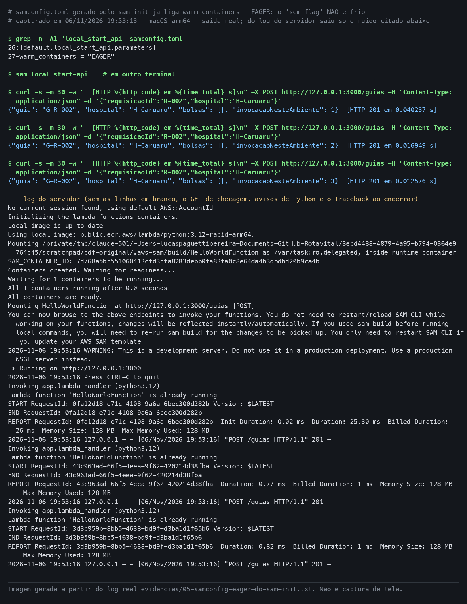
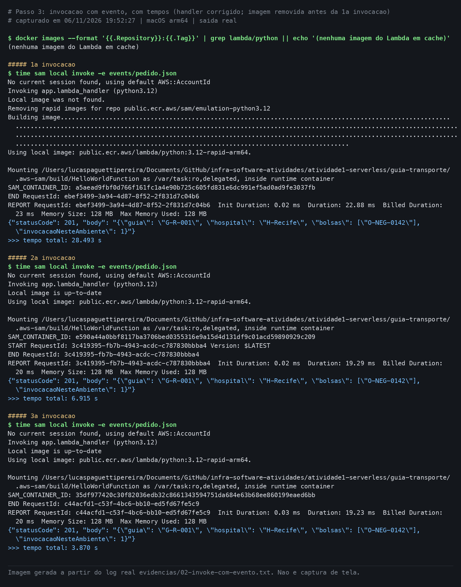
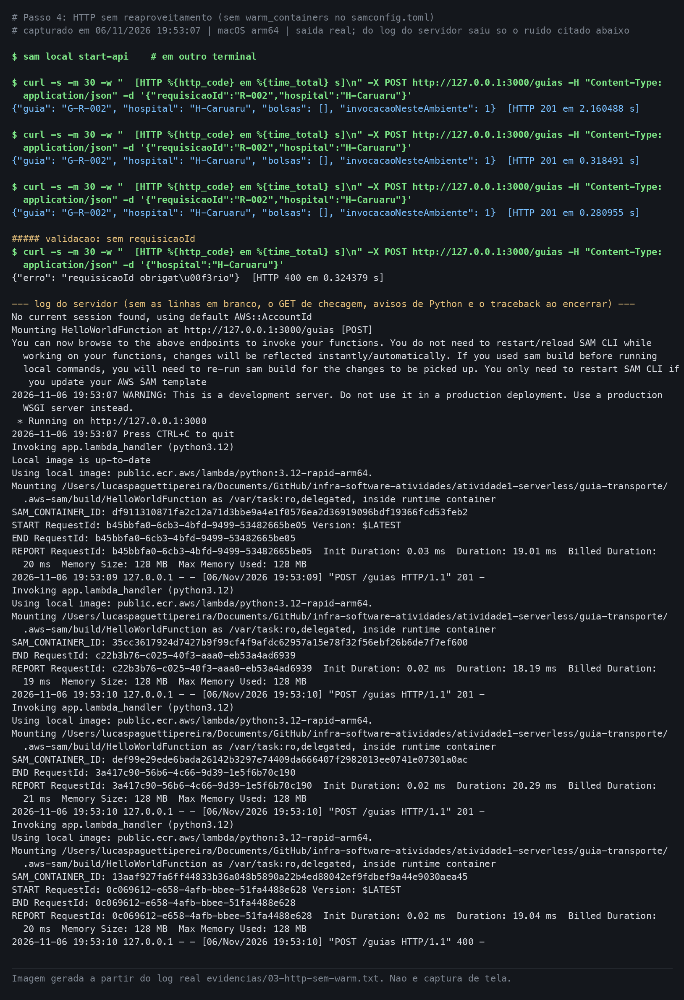
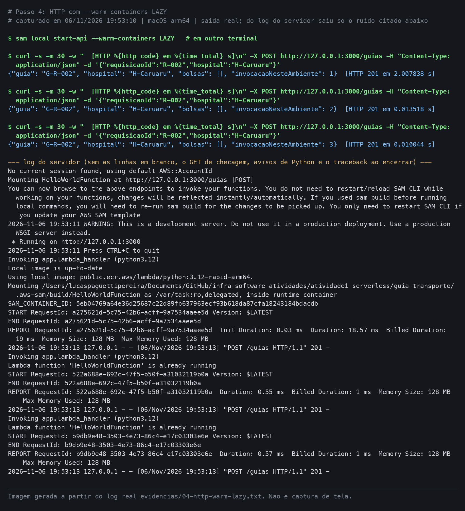
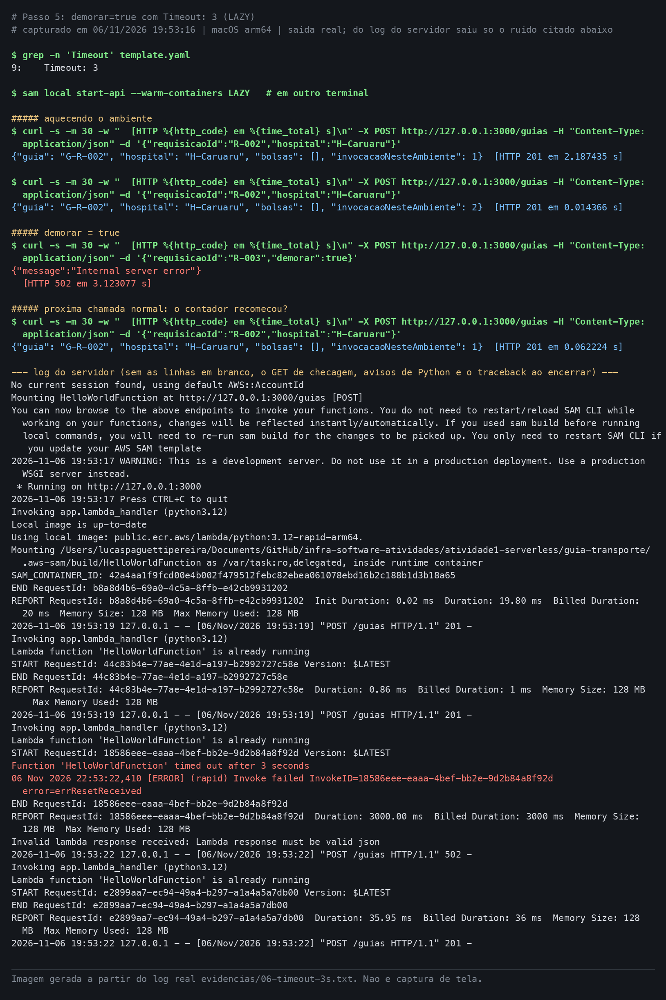

<h1 align="center">⚡☁️ Atividade individual 1: Serverless <br> Infraestrutura de Software <br> ADS · CESAR School · 2026.2</h1>

**Autor:** Lucas Paguetti Pereira  
**Entrega:** 24/11/2026, 19h15  
**Caminho escolhido:** A (AWS SAM CLI local, sem conta na AWS).  
**Vídeo:** ...

A função recebe um pedido de guia de transporte de uma requisição do Rota Vital e devolve a guia.
Serve para observar na prática o cold start, a reutilização do ambiente de execução, a falta de estado
garantido entre chamadas e o limite de tempo.

<h2 align="center" id="tecnologias"> ⛏️💻 Tecnologias Utilizadas: <br>

</h2>
<p align="center">
  
   <br>
  
  
  
   <br>
  
  
   <br>
  
  
  
  
   <br>
  
  
   <br>
</p>

O projeto foi criado com `sam init` (AWS Quick Start, Hello World, Python 3.12, pacote zip) e com a
arquitetura `arm64`, para o Docker rodar a imagem do Lambda sem emulação x86 no meu Mac.

<h2 align="center" id="estrutura"> 📁 Estrutura do Projeto: <br>

</h2>

```text
atividade1-serverless/
├── guia-transporte/              # projeto criado com sam init
│   ├── hello_world/
│   │   ├── app.py                # handler da função
│   │   └── requirements.txt
│   ├── events/pedido.json        # evento gerado com sam local generate-event
│   ├── template.yaml             # função, rota POST /guias e Timeout: 3
│   └── samconfig.toml            # sem o warm_containers = "EAGER" do sam init
├── evidencias/                   # log .txt e imagem .png de cada passo
└── README.md
```

<h2 align="center" id="como-funciona"> 🧭 Como Funciona: <br>

</h2>



A função pode ser chamada de dois jeitos: direto com um evento (`sam local invoke`) ou por HTTP, com o
`sam local start-api` fazendo o papel do API Gateway. Nos dois casos ela roda dentro de um container Docker com a
imagem do runtime do Lambda. O handler ([`app.py`](guia-transporte/hello_world/app.py)) faz cinco coisas, nesta ordem:

1. Soma 1 ao `contador`, uma variável global que só sobrevive se o ambiente de execução for reaproveitado.
2. Lê o `body` e, se ele vier com `isBase64Encoded`, decodifica antes do `json.loads`.
3. Sem `requisicaoId`, devolve **HTTP 400**.
4. Com `"demorar": true`, espera 5 segundos, mais que o `Timeout: 3` do [`template.yaml`](guia-transporte/template.yaml).
5. Devolve **HTTP 201** com a guia e o campo `invocacaoNesteAmbiente`, que é o valor do contador.

<h2 align="center" id="como-rodar"> 🚀 Como Rodar: <br>

</h2>

Pré-requisitos: Docker aberto, SAM CLI e Python 3.12 instalados.

```bash
cd atividade1-serverless/guia-transporte
sam build
```

**Invocação com evento (Passo 3).** Rode duas vezes e compare os tempos:

```bash
time sam local invoke -e events/pedido.json
```

O evento `events/pedido.json` foi gerado com:

```bash
sam local generate-event apigateway aws-proxy --method POST --path guias \
    --body '{"requisicaoId":"R-001","hospital":"H-Recife","bolsas":["O-NEG-0142"]}' \
    > events/pedido.json
```

**Chamada HTTP (Passo 4).** Em um terminal suba a API; em outro, faça a chamada três vezes:

```bash
sam local start-api
```

```bash
curl -X POST http://127.0.0.1:3000/guias -H "Content-Type: application/json" \
    -d '{"requisicaoId":"R-002","hospital":"H-Caruaru"}'
```

Depois pare o servidor com Ctrl+C e repita com o reaproveitamento ligado:

```bash
sam local start-api --warm-containers LAZY
```

**Limite de tempo (Passo 5).** Com o `Timeout: 3` que está no `template.yaml`:

```bash
curl -X POST http://127.0.0.1:3000/guias -H "Content-Type: application/json" \
    -d '{"requisicaoId":"R-003","demorar":true}'
```

Depois mude para `Timeout: 10`, rode `sam build`, suba a API de novo e repita. O repositório fica com
`Timeout: 3` de propósito, para o experimento poder ser refeito desde o início.

<h2 align="center" id="diferencas"> ⚠️ Diferenças em Relação ao PDF: <br>

</h2>

Seguindo o enunciado ao pé da letra, encontrei dois problemas. Registrei os dois porque mudam o resultado.

**1. O Passo 3 quebra com o handler do PDF.** O `sam local generate-event` entrega o `body` em base64, com
`isBase64Encoded: true`. O `json.loads` do handler recebe esse texto e lança `JSONDecodeError`
([evidência](evidencias/01-falha-base64-handler-do-pdf.txt)). Como esse é o formato que o enunciado diz vir do
API Gateway, corrigi o handler em vez de editar o evento, acrescentando a leitura de `isBase64Encoded`:

```python
corpo = event.get("body") or "{}"
if event.get("isBase64Encoded"):  # o evento do generate-event vem em base64
    corpo = base64.b64decode(corpo)
pedido = json.loads(corpo)
```

<p align="center">
  <br>
  <sub>Com o handler do PDF: o evento traz <code>isBase64Encoded = True</code>, o <code>body</code> é um texto em base64 e a linha 8 lança <code>JSONDecodeError</code>.</sub>
</p>

**2. O `start-api` "sem flag" já vinha aquecido.** O `samconfig.toml` gerado pelo `sam init` traz
`warm_containers = "EAGER"`. Com ele, o contador sobe 1, 2, 3 mesmo sem passar `--warm-containers`
([evidência](evidencias/05-samconfig-eager-do-sam-init.txt)). Para comparar com e sem reaproveitamento, tirei
essa configuração do `samconfig.toml`.

<details>
<summary>📸 Ver a evidência: contador subindo 1, 2, 3 com o <code>samconfig.toml</code> gerado pelo <code>sam init</code></summary>
<br>
<p align="center">
  <br>
  <sub>O <code>start-api</code> sem flag já mostra <code>Initializing the lambda functions containers</code> ao subir, antes de qualquer chamada.</sub>
</p>
</details>

<h2 align="center" id="resultados"> 📊 Resultados: <br>

</h2>

Tudo abaixo vem dos arquivos em [`evidencias/`](evidencias/). As imagens foram geradas a partir dos logs `.txt`;
clique em uma delas para ver em tamanho real.

### 1️⃣ Invocação com evento (Passo 3)

Antes da 1ª invocação apaguei a imagem do Lambda, para medir a primeira vez de verdade.

| Invocação | Tempo total | `Duration` da função | `invocacaoNesteAmbiente` |
| --- | --- | --- | --- |
| 1ª (precisou baixar a imagem) | 28,5 s | 22,88 ms | 1 |
| 2ª | 6,9 s | 19,29 ms | 1 |
| 3ª | 3,9 s | 19,23 ms | 1 |

A função levou cerca de 20 ms nas três; a diferença está no que acontece antes do handler. Na 1ª, o log mostra
`Local image was not found` e `Building image...`, porque o SAM precisou montar a imagem do runtime. Nas outras
aparece `Local image is up-to-date`. O `invocacaoNesteAmbiente` foi 1 nas três e o `SAM_CONTAINER_ID` mudou a cada
uma: o `sam local invoke` cria um container novo por execução.

<p align="center">
  <br>
  <sub>Três <code>sam local invoke</code> seguidos: só a 1ª precisou montar a imagem; o contador ficou em 1 nas três.</sub>
</p>

### 2️⃣ Chamada HTTP, com e sem reaproveitamento (Passo 4)

Três chamadas seguidas em cada modo:

| Modo | `invocacaoNesteAmbiente` | Tempo das chamadas | Containers usados |
| --- | --- | --- | --- |
| Sem reaproveitamento | 1, 1, 1 | 2,16 s · 0,32 s · 0,28 s | 3 diferentes |
| `--warm-containers LAZY` | 1, 2, 3 | 2,01 s · 0,014 s · 0,010 s | 1 |
| `EAGER` (samconfig do `sam init`) | 1, 2, 3 | 0,040 s · 0,017 s · 0,013 s | 1, criado ao subir a API |

Sem reaproveitamento, cada chamada ganhou um `SAM_CONTAINER_ID` diferente e o contador voltou a 1. Com `LAZY`, o
container foi criado na 1ª chamada e as seguintes aparecem no log como
`Lambda function 'HelloWorldFunction' is already running`. Só a 1ª traz `Init Duration`, e a `Duration` da função caiu
de 18,57 ms para cerca de 0,55 ms. No modo sem reaproveitamento também testei a validação: sem `requisicaoId`, a
resposta foi HTTP 400 com `requisicaoId obrigatório`. A linha do `EAGER` é a da [segunda diferença](#diferencas).

<table align="center">
  <tr>
    <th>Sem reaproveitamento</th>
    <th><code>--warm-containers LAZY</code></th>
  </tr>
  <tr>
    <td></td>
    <td></td>
  </tr>
  <tr>
    <td align="center"><sub>Contador 1, 1, 1 e três containers diferentes.</sub></td>
    <td align="center"><sub>Contador 1, 2, 3 em um único container.</sub></td>
  </tr>
</table>

### 3️⃣ Limite de tempo (Passo 5)

| Configuração | Resultado | Tempo |
| --- | --- | --- |
| `Timeout: 3`, `demorar: true` | HTTP 502 `{"message":"Internal server error"}` | 3,12 s |
| `Timeout: 10`, `demorar: true` | HTTP 201 com a guia G-R-003 | 9,07 s (1ª chamada, inclui subir o container) |

Antes do teste, aqueci o ambiente com `LAZY` e duas chamadas normais (contador 1 e 2). A chamada com
`demorar: true` foi cortada: o log do servidor mostra `Function 'HelloWorldFunction' timed out after 3 seconds` e
`Duration: 3000.00 ms`, e o cliente recebeu HTTP 502. A chamada normal feita logo depois voltou com o contador em 1,
em vez de 3. O log dessa chamada ainda diz `already running`, ou seja, o container era o mesmo, mas o runtime
dentro dele foi reiniciado (`errResetReceived`) e a variável global se perdeu. Com `Timeout: 10`, a mesma chamada
voltou 201 ([log](evidencias/07-timeout-10s.txt)).

<p align="center">
  <br>
  <sub>Com <code>Timeout: 3</code>: HTTP 502 aos 3,12 s e, na chamada seguinte, o contador de volta a 1.</sub>
</p>

<h2 align="center" id="respostas"> 💬 Respostas: <br>

</h2>

**1. Por que a primeira invocação demorou mais que a segunda? O que acontece na fase de Init?**

A função em si levou cerca de 20 ms nas três invocações. A diferença de 28,5 s para 6,9 s veio de antes do
handler: na primeira, o SAM precisou baixar a imagem do runtime, e nas seguintes ela já estava em cache. Esse é o
equivalente local do cold start.

Na nuvem, a fase de Init faz três coisas antes do primeiro `Invoke`: inicia as extensões, prepara o runtime e roda
o código estático da função, ou seja, o que fica fora do handler, como os imports e o `contador = 0`. Ela tem
limite de 10 segundos.

Dois cuidados com a medição local. O `sam local invoke` cria um container novo a cada execução (o contador foi
sempre 1), então a segunda invocação também é fria e só ficou mais rápida por causa do cache. E o `Init Duration`
que o emulador imprime (0,02 ms) não serve como medida. A comparação mais limpa entre frio e quente veio do modo
`LAZY`: 2,01 s na primeira chamada e 14 ms na segunda.

**2. O que o campo `invocacaoNesteAmbiente` mostrou com e sem `--warm-containers`? O que isso diz sobre guardar estado numa variável global da função?**

Sem reaproveitamento deu 1, 1, 1, com três containers diferentes: cada chamada ganhou um ambiente novo e a
variável voltou a zero. Com `LAZY` deu 1, 2, 3 em um único container, então a variável sobreviveu entre as
chamadas.

Isso mostra que a variável global dura só enquanto aquele ambiente viver, e quem decide isso é a plataforma. O
timeout mostrou o mesmo: depois dele o contador recomeçou em 1. Ela serve como cache, para reaproveitar uma conexão
por exemplo, mas não para guardar dado que não pode sumir. Com chamadas simultâneas seria pior, porque cada
ambiente teria o seu próprio contador. Estado precisa ficar fora da função, em um banco ou outro armazenamento.

**3. O que aconteceu com `demorar = true`? Qual é o tempo máximo de uma execução no Lambda, e o que fazer com um trabalho mais longo?**

Com `Timeout: 3`, a execução foi interrompida aos 3 segundos, antes de a função terminar os 5 de espera. O cliente
recebeu HTTP 502 e nenhuma guia foi gerada. O ambiente foi reiniciado, tanto que o contador voltou a 1 na chamada
seguinte; a documentação diz que o Lambda reinicia o ambiente quando há timeout no `Invoke`. Com `Timeout: 10`, a
mesma chamada retornou 201.

O máximo no Lambda é de 15 minutos (900 segundos) por invocação. Um trabalho mais longo pode ser quebrado em etapas
menores, encadeadas por fila ou pelo Step Functions, ou rodar em um serviço sem esse limite, como um container no
ECS ou o AWS Batch. A documentação também cita as Lambda durable functions, que podem durar até um ano.

**4. Quanto custa um milhão de execuções desta função com 128 MB e 100 ms?**

```text
Requisições:  1.000.000 × (US$ 0,20 / 1.000.000)   = US$ 0,20

Memória:      128 MB = 128 / 1024 GB               = 0,125 GB
Duração:      100 ms                               = 0,1 s
Por execução: 0,125 GB × 0,1 s                     = 0,0125 GB-s
Total:        0,0125 GB-s × 1.000.000              = 12.500 GB-s
Computação:   12.500 GB-s × US$ 0,0000166667       = US$ 0,2083

Total:        US$ 0,20 + US$ 0,2083                = US$ 0,4083 (cerca de US$ 0,41)
```

Na faixa gratuita mensal (1 milhão de requisições e 400 mil GB-s), esse volume sairia de graça.

**5. Em que parte do Rota Vital uma função assim faria sentido, e em qual não faria?**

Faria sentido na emissão da guia de transporte quando uma requisição é alocada, um fluxo que ainda não existe no
sistema. É um trabalho curto, disparado por evento e sem estado próprio: recebe o id, grava a guia no banco e
termina. As requisições chegam em momentos irregulares, então não haveria servidor parado pagando por nada.

Não faria sentido na API principal em Spring Boot, que recebe chamadas o tempo todo, mantém conexões com o Postgres
e sofreria com o tempo de início da JVM em cada ambiente novo. Também não serviria para a
`FilaRequisicoesHospitalares`, que hoje é um `ArrayDeque` em memória: virar variável global de função seria perder
requisições a cada ambiente novo, exatamente o que o contador mostrou.

<h2 align="center" id="evidencias"> 🧾 Evidências: <br>

</h2>

| Arquivo | O que mostra | Imagem |
| --- | --- | :---: |
| [`00-ambiente`](evidencias/00-ambiente.txt) | Versões das ferramentas | [🖼️](evidencias/00-ambiente.png) |
| [`01-falha-base64-handler-do-pdf`](evidencias/01-falha-base64-handler-do-pdf.txt) | Passo 3 com o handler original quebrando | [🖼️](evidencias/01-falha-base64-handler-do-pdf.png) |
| [`02-invoke-com-evento`](evidencias/02-invoke-com-evento.txt) | Três invocações com evento, com os tempos | [🖼️](evidencias/02-invoke-com-evento.png) |
| [`03-http-sem-warm`](evidencias/03-http-sem-warm.txt) | HTTP sem reaproveitamento e validação 400 | [🖼️](evidencias/03-http-sem-warm.png) |
| [`04-http-warm-lazy`](evidencias/04-http-warm-lazy.txt) | HTTP com `LAZY` | [🖼️](evidencias/04-http-warm-lazy.png) |
| [`05-samconfig-eager-do-sam-init`](evidencias/05-samconfig-eager-do-sam-init.txt) | Efeito do `EAGER` que o `sam init` gera | [🖼️](evidencias/05-samconfig-eager-do-sam-init.png) |
| [`06-timeout-3s`](evidencias/06-timeout-3s.txt) | Erro de tempo limite e contador reiniciado | [🖼️](evidencias/06-timeout-3s.png) |
| [`07-timeout-10s`](evidencias/07-timeout-10s.txt) | Mesma chamada com `Timeout: 10` | [🖼️](evidencias/07-timeout-10s.png) |

Cada arquivo `.txt` traz o log completo. O `.png` de mesmo nome é uma imagem gerada a partir desse log, para leitura
rápida; não é uma captura de tela.

<h2 align="center" id="fontes"> 📚 Fontes: <br>

</h2>

- [Cotas do Lambda](https://docs.aws.amazon.com/lambda/latest/dg/gettingstarted-limits.html)
- [Ciclo de vida do ambiente de execução](https://docs.aws.amazon.com/lambda/latest/dg/lambda-runtime-environment.html)
- [Preços do Lambda](https://aws.amazon.com/lambda/pricing)

<h2 align="center" id="uso-de-ia"> 🤖 Uso de IA: <br>

</h2>

Declaração conforme a PO-CESAR-021.

- **Ferramenta:** Claude Code (modelo Claude Opus 5.5).
- **Finalidade:** instalar as ferramentas, executar os passos no meu computador e coletar os logs; investigar os dois
  problemas descritos acima e propor a correção do handler; gerar as imagens a partir dos logs; redigir este README e
  o rascunho das respostas; preparar o roteiro do vídeo.
- **Como validei:** ...