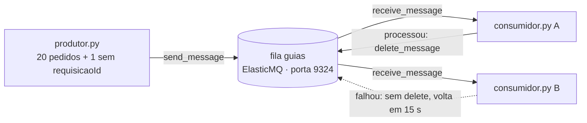
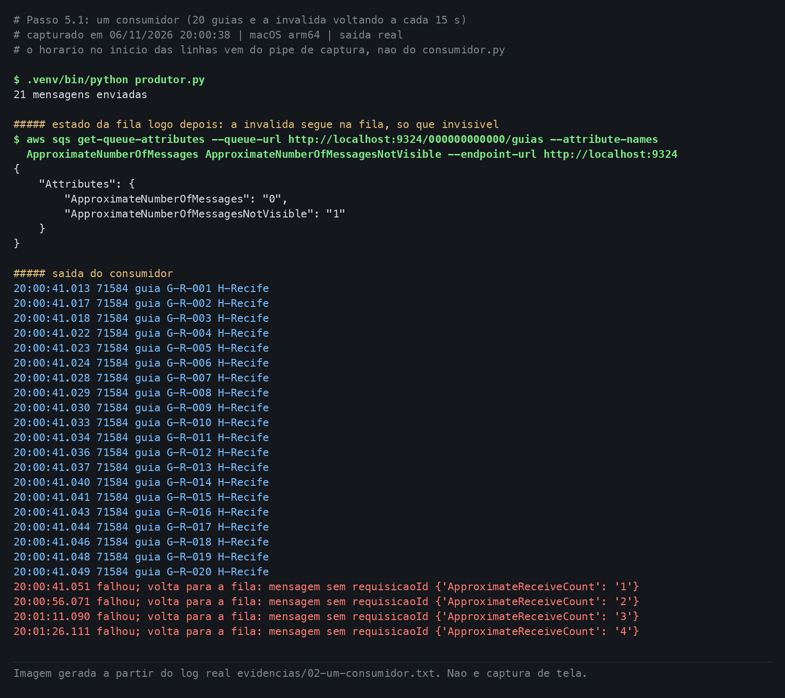
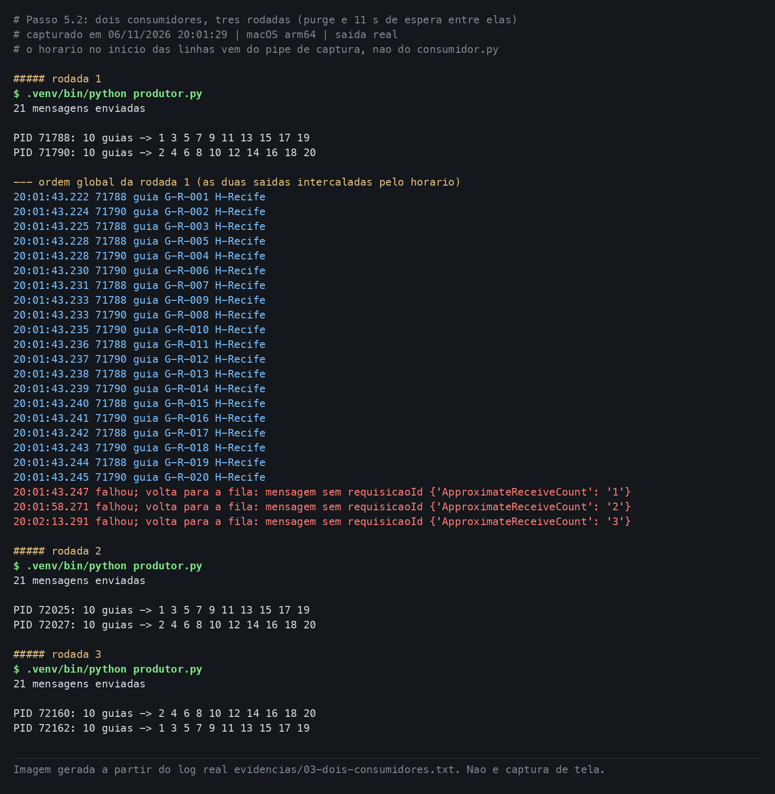
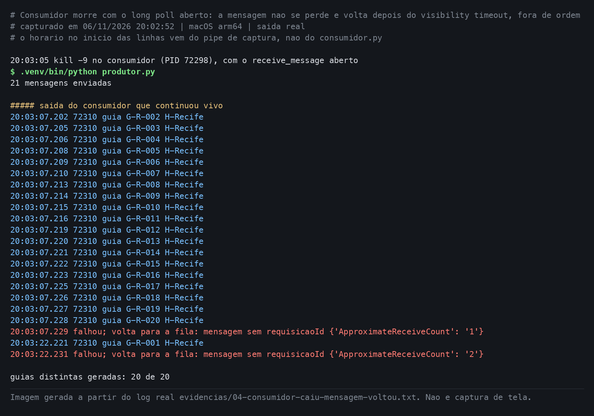
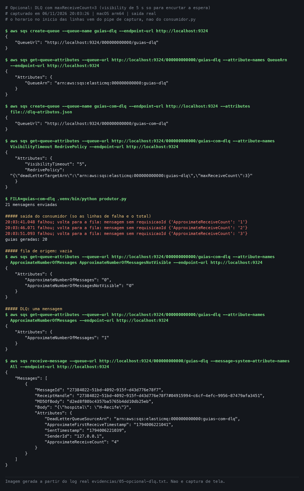

<h1 align="center">📨📬 Atividade individual 2: Mensageria <br>
Infraestrutura de Software · ADS · CESAR School · 2026.2</h1>

**Autor:** Lucas Paguetti Pereira  
**Entrega:** 01/12/2026, 19h15  
**Caminho escolhido:** A (ElasticMQ local em Docker, sem conta na AWS).  
**Vídeo:** ...

Um produtor publica pedidos de guia de transporte do Rota Vital em uma fila compatível com o Amazon SQS, e os
consumidores retiram, processam e confirmam. Serve para observar que a mensagem só sai da fila com a confirmação,
que vários consumidores dividem o trabalho, que a fila padrão entrega pelo menos uma vez e que uma falha faz a
mensagem voltar depois do visibility timeout.

<h2 align="center" id="tecnologias"> ⛏️💻 Tecnologias Utilizadas: <br>

</h2>
<p align="center">
  
   <br>
  
  
  
  
   <br>
  
  
   <br>
  
   <br>
  
   <br>
</p>

A fila roda na imagem Docker `softwaremill/elasticmq-native`.

<h2 align="center" id="estrutura"> 📁 Estrutura do Projeto: <br>

</h2>

```text
atividade2-mensageria/
├── produtor.py           # envia 20 pedidos válidos e 1 sem requisicaoId
├── consumidor.py         # recebe, processa e só então apaga
├── dlq-atributos.json    # visibility de 5 s e RedrivePolicy da fila com DLQ
├── requirements.txt      # boto3
├── evidencias/           # log .txt e imagem .png de cada passo
└── README.md
```

`consumidor.py` e `produtor.py` são os do enunciado, com uma única mudança: o nome da fila pode vir da variável de
ambiente `FILA`, para rodar o experimento da DLQ. Sem a variável, o nome continua sendo `guias`.

<h2 align="center" id="como-funciona"> 🧭 Como Funciona: <br>

</h2>



O produtor publica 21 mensagens na fila `guias`. Cada consumidor fica em um laço que faz três coisas:

1. Pede até 10 mensagens com `receive_message` e espera até 10 segundos por elas (`WaitTimeSeconds=10`, o long polling).
2. Para cada mensagem, chama `processar`, que imprime a guia ou lança erro se faltar `requisicaoId`.
3. Só depois de processar chama `delete_message`. Se der erro, a mensagem não é apagada e volta a ficar visível
   quando acaba o visibility timeout (15 segundos na fila `guias`).

No experimento opcional, a fila `guias-com-dlq` tem uma `RedrivePolicy` ([`dlq-atributos.json`](dlq-atributos.json)):
depois de 3 recebimentos sem sucesso, a mensagem vai para a `guias-dlq`.

<h2 align="center" id="como-rodar"> 🚀 Como Rodar: <br>

</h2>

Pré-requisitos: Docker aberto, AWS CLI v2 e Python 3.12 instalados.

**Terminal 1: subir a fila.**

```bash
docker run --rm -p 9324:9324 softwaremill/elasticmq-native
```

**Terminal 2: criar a fila e o ambiente Python.** As credenciais são falsas: o ElasticMQ aceita qualquer valor, mas
a CLI exige que existam.

```bash
cd atividade2-mensageria
export AWS_ACCESS_KEY_ID=x AWS_SECRET_ACCESS_KEY=x AWS_DEFAULT_REGION=us-east-1
aws sqs create-queue --queue-name guias --attributes VisibilityTimeout=15 \
    --endpoint-url http://localhost:9324
python3.12 -m venv .venv
source .venv/bin/activate
pip install -r requirements.txt
```

**Um consumidor.** Em um terminal rode o consumidor; no Terminal 2, o produtor:

```bash
python consumidor.py
```

```bash
python produtor.py
```

**Dois consumidores.** Pare o consumidor com Ctrl+C, abra dois terminais com `python consumidor.py` (ative o `.venv`
em cada um) e rode o produtor de novo.

**Entre uma rodada e outra,** limpe a fila e espere pelo menos 10 segundos antes de subir os consumidores:

```bash
aws sqs purge-queue --queue-url http://localhost:9324/000000000000/guias \
    --endpoint-url http://localhost:9324
```

São dois motivos, os dois vistos na prática. Sem o `purge`, a mensagem inválida da rodada anterior continua
circulando. Sem a espera, o `receive_message` do consumidor que foi parado continua aberto no servidor por até 10
segundos (o `WaitTimeSeconds`), e a fila pode entregar mensagens a esse consumidor que já não existe. Elas não se
perdem, mas só voltam depois do visibility timeout.

**Opcional: DLQ.**

```bash
aws sqs create-queue --queue-name guias-dlq --endpoint-url http://localhost:9324
aws sqs create-queue --queue-name guias-com-dlq --attributes file://dlq-atributos.json \
    --endpoint-url http://localhost:9324
FILA=guias-com-dlq python consumidor.py
FILA=guias-com-dlq python produtor.py
```

<h2 align="center" id="resultados"> 📊 Resultados: <br>

</h2>

Tudo abaixo vem dos arquivos em [`evidencias/`](evidencias/). As imagens foram geradas a partir dos logs `.txt`;
clique em uma delas para ver em tamanho real.

### 1️⃣ Um consumidor

O produtor enviou 21 mensagens: 20 pedidos válidos (R-001 a R-020) e um sem `requisicaoId`. O consumidor gerou as 20
guias em cerca de 40 ms (de 20:00:41.013 a 20:00:41.049), apagando cada mensagem depois de processar. A inválida
falhou no `processar`, não foi apagada e reapareceu a cada 15 segundos:

| Horário | `ApproximateReceiveCount` |
| --- | --- |
| 20:00:41 | 1 |
| 20:00:56 | 2 |
| 20:01:11 | 3 |
| 20:01:26 | 4 |

Três segundos depois do envio, a fila mostrava `ApproximateNumberOfMessages: 0` e
`ApproximateNumberOfMessagesNotVisible: 1`: a mensagem inválida continuava na fila, só que invisível.

<p align="center">
  <br>
  <sub>As 20 guias saem de uma vez; a mensagem inválida volta às 20:00:41, 20:00:56, 20:01:11 e 20:01:26.</sub>
</p>

### 2️⃣ Dois consumidores

Rodei o produtor três vezes com dois consumidores no ar, limpando a fila e esperando 11 segundos entre as rodadas.

| Rodada | Consumidor A | Consumidor B |
| --- | --- | --- |
| 1 | 10 guias (R-001, R-003, R-005...) | 10 guias (R-002, R-004, R-006...) |
| 2 | 10 guias (ímpares) | 10 guias (pares) |
| 3 | 10 guias (pares) | 10 guias (ímpares) |

Na rodada 1, a saída dos dois consumidores, intercalada pelo horário, mostra os dois trabalhando ao mesmo tempo, cada
um em ordem crescente: a R-001 e a R-002 saíram com 2 ms de diferença, uma em cada consumidor. Nas rodadas 2 e 3 o
log traz só a contagem de cada consumidor.

<p align="center">
  <br>
  <sub>Três rodadas com dois consumidores: 10 guias para cada um, alternando ímpares e pares.</sub>
</p>

### 3️⃣ Consumidor que cai

Matei um dos consumidores com `kill -9` às 20:03:05 e rodei o produtor logo em seguida. O `receive_message` dele
ainda estava aberto no servidor, então a fila entregou a R-001 a um consumidor que já não existia. O consumidor que
continuou vivo processou da R-002 à R-020 às 20:03:07, e a R-001 voltou sozinha às 20:03:22, 15 segundos depois,
quando acabou o visibility timeout. No fim, 20 guias distintas foram geradas, e nenhuma se perdeu.

<p align="center">
  <br>
  <sub>A R-001 ficou presa com o consumidor morto e voltou 15 segundos depois, já fora de ordem.</sub>
</p>

### 4️⃣ DLQ (opcional)

Criei a `guias-dlq` e a `guias-com-dlq`, esta com `maxReceiveCount` 3. A mensagem inválida falhou três vezes
(20:03:41, 20:03:46 e 20:03:51) e foi para a `guias-dlq`, com a origem registrada em `DeadLetterQueueSourceArn`. As
20 guias válidas saíram normalmente e a fila de origem ficou vazia. Usei visibility timeout de 5 segundos nessa fila
só para encurtar a espera.

<details>
<summary>📸 Ver a evidência: mensagem inválida indo para a DLQ depois de 3 tentativas</summary>
<br>
<p align="center">
  <br>
  <sub>Três falhas de 5 em 5 segundos, fila de origem vazia e a mensagem na <code>guias-dlq</code>.</sub>
</p>
</details>

<h2 align="center" id="respostas"> 💬 Respostas: <br>

</h2>

**1. Por que o consumidor só apaga a mensagem depois de processar? O que aconteceria se apagasse antes?**

Porque apagar é a confirmação de que o trabalho terminou. Se o consumidor cair no meio, a mensagem continua na fila
e volta depois do visibility timeout, para outro consumidor tentar. Vi isso ao matar um consumidor: a R-001 ficou com
ele, não foi processada e voltou 15 segundos depois, e nenhuma guia se perdeu.

Se apagasse antes, uma falha entre apagar e processar perderia a mensagem para sempre: o hospital teria feito o
pedido, a guia nunca sairia e nada avisaria ninguém.

**2. Com dois consumidores, como as mensagens se dividiram? A ordem foi mantida? O que a documentação do SQS diz sobre ordem nas filas padrão?**

Dividiram-se quase por igual: 10 para cada um nas três rodadas, com um ficando com as ímpares e o outro com as
pares. Isso não é uma garantia, pois em um teste anterior, sem log guardado, deu 9 e 11. Cada consumidor recebeu as
suas mensagens em ordem crescente, e no conjunto a ordem ficou praticamente a de envio.

Mas a ordem não é garantida. No teste do consumidor que caiu, a R-001 foi processada depois da R-020. Além disso, o
ElasticMQ roda em um único processo local, enquanto o SQS real é distribuído. A documentação diz que, nas filas
padrão, "messages may occasionally arrive out of order" e que elas fazem "a best-effort attempt to maintain the
order in which messages are sent". Ou seja, tentam manter a ordem, sem prometer. Quem precisa de ordem usa fila FIFO.

**3. A fila padrão garante entrega pelo menos uma vez, e a mesma mensagem pode chegar duas vezes. O que isso exige do consumidor? Como vocês o tornariam idempotente?**

Exige que processar a mesma mensagem duas vezes tenha o mesmo efeito de processar uma. No Rota Vital isso importa:
uma guia duplicada pode significar dois transportes para a mesma bolsa.

Eu usaria o `requisicaoId` como chave, porque ele identifica o pedido de verdade, e o `MessageId` muda se o produtor
reenviar. A tabela de guias teria `UNIQUE (requisicao_id)` e o consumidor faria
`INSERT ... ON CONFLICT (requisicao_id) DO NOTHING`. Na segunda entrega nada novo é criado, e o consumidor apaga a
mensagem normalmente. Deixaria essa regra no banco, e não em um `SELECT` antes do `INSERT`, porque dois consumidores
poderiam fazer o `SELECT` ao mesmo tempo e os dois achariam que a guia ainda não existe.

**4. Expliquem o visibility timeout com o que viram na mensagem inválida. Para que serve uma DLQ?**

Quando um consumidor recebe uma mensagem, ela não sai da fila: fica invisível para os outros durante o visibility
timeout, 15 segundos aqui. Se não for apagada nesse prazo, volta a ficar visível. A mensagem inválida mostrou isso:
o `processar` lança erro, o `delete_message` nunca roda, e ela voltou às 20:00:41, 20:00:56, 20:01:11 e 20:01:26,
com o `ApproximateReceiveCount` subindo de 1 a 4. Nesse meio-tempo a fila a contava como `NotVisible`.

O problema é que uma mensagem assim nunca vai dar certo e ficaria voltando sem parar. A DLQ é uma fila separada para
onde ela vai depois de um número máximo de tentativas, o `maxReceiveCount`. No meu teste, com 3, ela saiu da fila
principal depois da terceira falha. Assim ela para de gastar processamento e fica guardada para alguém investigar.

**5. No Rota Vital, qual a diferença entre o hospital chamar a emissão de guia diretamente (síncrono) e passar por uma fila (assíncrono)? O que se ganha e o que se perde?**

No síncrono, o hospital chama a emissão e espera: recebe a guia na hora, mas se o serviço estiver fora do ar ou
lento, o pedido falha ou trava junto.

Na fila, o hospital só publica o pedido e segue. Ganha-se desacoplamento (o pedido fica guardado mesmo com o serviço
fora do ar), absorção de picos, escala simples (basta subir mais consumidores, como fiz com dois) e nova tentativa
automática.

Perde-se a resposta imediata: o hospital recebe "pedido recebido", não a guia, e precisa consultar o status ou ser
avisado depois. O sistema também fica mais complexo, com fila, DLQ, monitoramento e consumidor idempotente. E uma
fila única não tem prioridade: no Rota Vital, um pedido de urgência `ALTA` esperaria atrás dos outros, então seria
preciso uma fila por nível de urgência. Para sangue, eu registraria o pedido de forma síncrona, para o hospital ter
a confirmação na hora, e faria a emissão da guia pela fila.

<h2 align="center" id="evidencias"> 🧾 Evidências: <br>

</h2>

| Arquivo | O que mostra | Imagem |
| --- | --- | :---: |
| [`01-fila-no-ar`](evidencias/01-fila-no-ar.txt) | ElasticMQ no ar e fila criada com visibility timeout de 15 s | [🖼️](evidencias/01-fila-no-ar.png) |
| [`02-um-consumidor`](evidencias/02-um-consumidor.txt) | 20 guias e a mensagem inválida voltando a cada 15 s | [🖼️](evidencias/02-um-consumidor.png) |
| [`03-dois-consumidores`](evidencias/03-dois-consumidores.txt) | Divisão entre dois consumidores, em três rodadas | [🖼️](evidencias/03-dois-consumidores.png) |
| [`04-consumidor-caiu-mensagem-voltou`](evidencias/04-consumidor-caiu-mensagem-voltou.txt) | Consumidor morto, mensagem preservada e fora de ordem | [🖼️](evidencias/04-consumidor-caiu-mensagem-voltou.png) |
| [`05-opcional-dlq`](evidencias/05-opcional-dlq.txt) | Opcional: mensagem inválida indo para a DLQ | [🖼️](evidencias/05-opcional-dlq.png) |

Cada arquivo `.txt` traz o log da execução. O horário no início das linhas das saídas do consumidor foi acrescentado
pelo script de captura, e não pelo `consumidor.py`. O `.png` de mesmo nome é uma imagem gerada a partir desse log,
para leitura rápida; não é uma captura de tela.

<h2 align="center" id="fontes"> 📚 Fontes: <br>

</h2>

- [Filas padrão do SQS](https://docs.aws.amazon.com/AWSSimpleQueueService/latest/SQSDeveloperGuide/standard-queues.html)
- [Visibility timeout](https://docs.aws.amazon.com/AWSSimpleQueueService/latest/SQSDeveloperGuide/sqs-visibility-timeout.html)
- [Filas de mensagens mortas](https://docs.aws.amazon.com/AWSSimpleQueueService/latest/SQSDeveloperGuide/sqs-dead-letter-queues.html)
- [ElasticMQ](https://github.com/softwaremill/elasticmq)

<h2 align="center" id="uso-de-ia"> 🤖 Uso de IA: <br>

</h2>

Declaração conforme a PO-CESAR-021.

- **Ferramenta:** Claude Code (modelo Claude Opus 5.5).
- **Finalidade:** instalar as ferramentas, executar os passos no meu computador e coletar os logs; investigar o caso das
  mensagens atrasadas depois de parar um consumidor; montar o experimento opcional da DLQ; gerar as imagens a partir dos
  logs; redigir este README e o rascunho das respostas; preparar o roteiro do vídeo.
- **Como validei:** ...